  

# 🚀 Awesome Modern Open-Source Terminal & Workspaces 💻⚡

  
  
  
  
  

> 🌟 **A carefully curated index of modern GPU-accelerated terminal emulators, AI-augmented terminal workspaces, persistent multiplexers, cloud/SaaS developer command-line environments, and next-generation shell toolchains.**

---

## 📑 Table of Contents
- [🌐 Sector Overview & Market Dynamics](#-sector-overview--market-dynamics)
- [☁️ Cloud & SaaS Terminal Platforms](#️-cloud--saas-terminal-platforms)
- [💻 Open-Source GitHub Projects](#-open-source-github-projects)
- [🛠️ Modern Shell Ecosystem & CLI Enhancements](#️-modern-shell-ecosystem--cli-enhancements)
- [🤝 How to Contribute](#-how-to-contribute)
- [💖 Support & Sponsorship](#-support--sponsorship)
- [⚠️ Disclaimer](#️-disclaimer)
- [📈 Star History](#-star-history)

---

## 🌐 Sector Overview & Market Dynamics

The global cloud developer environment, terminal infrastructure, and AI developer tooling market is estimated at **$7.5 billion in 2026** (projected to reach **$18.2 billion by 2032**, expanding at a **15.8% CAGR**).

Market dynamics across modern terminal workspaces reflect a **moderately fragmented sector transitioning into specialized market tiers**:
- **Enterprise & Cloud Infrastructure (Concentrated / Oligopoly)**: Hyper-scalers (Microsoft/GitHub Codespaces, AWS CloudShell, Google Cloud Shell) and Zero-Trust access providers (Teleport) dominate cloud infrastructure access and identity governance through platform bundling.
- **AI-Native & Desktop Terminal Workspaces (Fragmented & Highly Competitive)**: Fast-moving innovative startups (Warp, Replit, Termius) compete directly with high-performance open-source foundations (Ghostty, WezTerm, Zellij, Alacritty, Kitty). Rather than a single "winner-take-all" monopolistic outcome, developer loyalty is split between native cross-platform efficiency, local privacy/customizability, and agentic AI-assisted team collaboration layers.

---

## ☁️ Cloud & SaaS Terminal Platforms

The table below catalogs premier SaaS and cloud-hosted terminal workspaces, ranked in descending order by parent company scale (valuation or annual revenue run-rate):

| Platform | Category & Core Focus | Company Scale (Valuation / Revenue) | Starting Price (Paid Tier) | Free Tier Limit / Policy |
| :--- | :--- | :--- | :--- | :--- |
| **[AWS CloudShell](https://aws.amazon.com/cloudshell/)** | Browser-based pre-authenticated AWS CLI management environment | **Valuation: ~$2.1T+** *(Amazon market cap)* | **$0.00 / pay-as-you-go** *(Charges apply only to underlying AWS resources utilized)* | **Free forever plan**: Up to 10 concurrent shell sessions per AWS region; includes 1 GB persistent storage per AWS region at zero cost. |
| **[Google Cloud Shell](https://cloud.google.com/shell)** | Cloud development & management workspace with built-in Cloud Code & web preview | **Valuation: ~$2.0T+** *(Alphabet market cap)* | **$0.00 / pay-as-you-go** *(Zero charge for Cloud Shell VM compute; standard resource consumption rates apply)* | **Free forever plan**: 50 hours of weekly usage limit per user; includes 5 GB of persistent `$HOME` directory storage. |
| **[GitHub Codespaces](https://github.com/features/codespaces)** | Cloud-hosted remote development containers with full browser/SSH terminal | **Valuation: ~$100B+** *(Acquired by Microsoft / $3.1T parent cap)* | **$0.18/hour** *(Starting compute price for standard 2-core instances)* | **Free forever plan**: 60 core-hours of compute and 15 GB storage per month for all personal GitHub accounts. |
| **[Teleport Web Terminal](https://goteleport.com/)** | Identity-native Zero-Trust access platform with audited browser/SSH sessions | **Valuation: $1.1B+** *(Series C unicorn)* | **$7.00/user/month** *(Teleport Enterprise Cloud starting tier, billed annually)* | **14-day full feature free trial** with access for up to 5 team members, unlimited SSH session recording, and RBAC audits. |
| **[Replit Shell & Workspaces](https://replit.com/)** | Collaborative browser development environment, multiplayer terminal & AI agent | **Valuation: ~$900M+** *(Series B)* | **$20.00/month** *(Replit Core annual tier; or $25 billed monthly)* | **Free forever plan**: Unlimited public repls, basic CPU/RAM containers, and standard public shell access. |
| **[Warp Terminal](https://www.warp.dev/)** | Modern GPU Rust terminal with inline AI agents, blocks, and shared team workflows | **Valuation: ~$500M+** *(Series B funded by Sequoia & GV)* | **$20.00/user/month** *(Warp Team tier, billed annually; or $25 billed monthly)* | **Free forever plan**: Up to 3 team members, full terminal features, 100 Warp AI requests per user per month. |
| **[Termius](https://termius.com/)** | Cloud-synchronized cross-platform SSH, Mosh, SFTP client, and snippet vault | **Revenue: ~$25M ARR** *(Self-sustaining & profitable)* | **$10.00/user/month** *(Termius Pro annual plan; or $12 billed monthly)* | **Free forever plan (Starter tier)**: Core SSH/Mosh client on unlimited devices, Local Port Forwarding, and local config storage. |
| **[Shellngn](https://shellngn.com/)** | Web-based SSH, SFTP, VNC, and RDP cloud terminal gateway | **Revenue: ~$1M–$3M ARR** *(Bootstrapped boutique SaaS)* | **$5.00/month** *(Shellngn Cloud Standard tier)* | **14-day free trial** with full access to SSH, SFTP, VNC, RDP clients, and unlimited host connections. |

---

## 💻 Open-Source GitHub Projects

The premier open-source terminal emulators, workspaces, multiplexers, and remote terminal utilities, **sorted strictly by GitHub Star count (descending)**:

| Project | Stars | Language / Engine | Highlights & Architecture |
| :--- | :---: | :--- | :--- |
| **[Windows Terminal](https://github.com/microsoft/terminal)** |  | C++ / DirectX | Modern, fast GPU-accelerated terminal for Windows with tabs, split panes, Unicode rendering, and WSL integration. |
| **[fzf](https://github.com/junegunn/fzf)** |  | Go | Blazingly fast, interactive general-purpose command-line fuzzy finder for commands, files, and git history. |
| **[Tabby](https://github.com/Eugeny/tabby)** |  | TypeScript / Electron | Highly configurable cross-platform terminal emulator, serial console, and SSH client with connection management. |
| **[Alacritty](https://github.com/alacritty/alacritty)** |  | Rust / OpenGL | Minimalist, ultra-fast GPU-accelerated terminal emulator focused on extreme performance, low latency, and portability. |
| **[Ghostty](https://github.com/ghostty-org/ghostty)** |  | Zig / Metal & GTK4 | Next-gen, ultra-fast native terminal emulator by Mitchell Hashimoto leveraging platform-native UI and GPU shaders. |
| **[bat](https://github.com/sharkdp/bat)** |  | Rust | Modern `cat` clone with syntax highlighting for dozens of languages, Git integration, and automatic paging. |
| **[Starship](https://github.com/starship/starship)** |  | Rust | The minimal, blazing-fast, and infinitely customizable cross-shell prompt for Bash, Zsh, Fish, Nushell, and PowerShell. |
| **[tmux](https://github.com/tmux/tmux)** |  | C | The battle-tested terminal multiplexer enabling persistent detached sessions, window management, and remote workflows. |
| **[Hyper](https://github.com/vercel/hyper)** |  | JavaScript / Web | Elegant, extensible terminal emulator built entirely on HTML, CSS, and Electron with a massive theme and plugin ecosystem. |
| **[Nushell](https://github.com/nushell/nushell)** |  | Rust | Revolutionary structured data shell treating outputs as tabular pipelines (JSON/YAML/CSV/SQL) instead of raw text streams. |
| **[zoxide](https://github.com/ajeetdsouza/zoxide)** |  | Rust | Smarter, frecency-based directory navigation CLI tool that replaces `cd` with instant jumping across all shells. |
| **[Zellij](https://github.com/zellij-org/zellij)** |  | Rust / WASM | Batteries-included terminal workspace and multiplexer featuring layout presets, floating panes, and WebAssembly plugins. |
| **[Kitty](https://github.com/kovidgoyal/kitty)** |  | C & Python / OpenGL | Power-user GPU terminal emulator supporting the Kitty Graphics Protocol, scriptable Python kittens, and window tiling. |
| **[Atuin](https://github.com/atuinsh/atuin)** |  | Rust / SQLite | Replaces shell history with a SQLite database, fuzzy search UI, shell metrics, and optional end-to-end encrypted sync. |
| **[WezTerm](https://github.com/wezterm/wezterm)** |  | Rust / Lua | Feature-packed GPU terminal emulator and multiplexer configurable entirely in Lua with native SSH domains and font shaping. |
| **[eza](https://github.com/eza-community/eza)** |  | Rust | Modern, maintained replacement for `ls` featuring Git status markers, file metadata coloring, symlink dereferencing, and icons. |
| **[Wave Terminal](https://github.com/wavetermdev/waveterm)** |  | Go & TypeScript / Electron | Open-source block-based terminal workspace uniting traditional shells with inline file previews, web rendering, and AI chat. |
| **[GoTTY](https://github.com/yudai/gotty)** |  | Go | Simple Go CLI utility that turns any command-line tool or shell into a real-time web application via WebSockets. |
| **[iTerm2](https://github.com/gnachman/iTerm2)** |  | Objective-C | The standard open-source macOS terminal replacement offering split panes, tmux integration, triggers, and inline graphics. |
| **[ttyd](https://github.com/tsl0922/ttyd)** |  | C / libwebsockets | Ultra-lightweight command-line tool for sharing terminal sessions over the web with SSL, auth, and fast data transfer. |
| **[Rio Terminal](https://github.com/raphamorim/rio)** |  | Rust / WebGPU | Hardware-accelerated GPU terminal built with `wgpu`, running smoothly on desktop operating systems and in web browsers via WASM. |
| **[Contour](https://github.com/contour-terminal/contour)** |  | C++20 / OpenGL | High-DPI modern C++ terminal emulator with full VT conformance, Sixel/Kitty graphics, and configurable key actions. |
| **[Extraterm](https://github.com/sedwards2009/extraterm)** |  | TypeScript | Swiss Army chainsaw terminal emulator with command isolation frames, text output editing, and image/PDF previews. |

---

## 🛠️ Modern Shell Ecosystem & CLI Enhancements

Upgrade your command-line workflow by composing these complementary open-source components:

- 🎨 **Typefaces & Icons**: [Nerd Fonts](https://github.com/ryanoasis/nerd-fonts) (JetBrainsMono Nerd Font, FiraCode Nerd Font) for developer glyphs and symbols.
- 🎨 **Aesthetic Themes**: [Catppuccin](https://github.com/catppuccin/catppuccin) and [Tokyo Night](https://github.com/folke/tokyonight.nvim) universal palette configurations across all emulators.
- 🤖 **AI Shell Assistants**: [Aider](https://github.com/paul-gauthier/aider), [ShellGPT](https://github.com/TheR1D/shell_gpt), and [OpenCode](https://github.com/anomaly/opencode) for autonomous coding and shell translation.
- 🗂️ **Navigation & Multiplexing**: Combine **Ghostty** or **Alacritty** with **Zellij**, **Starship**, **zoxide**, and **fzf** for a snappy, lightning-fast developer terminal workstation.

---

## 🤝 How to Contribute

Contributions, project suggestions, and documentation improvements are warmly welcomed! 🌟

1. 🍴 **Fork** this repository.
2. 🌿 **Create a new branch** (`git checkout -b feature/add-new-terminal`).
3. ✏️ **Add your project** to the appropriate table or list (please maintain descending star count order and include pricing/specs).
4. 💾 **Commit your changes** (`git commit -m 'feat: Add Awesome-Terminal-Project'`).
5. 🚀 **Push to your branch** (`git push origin feature/add-new-terminal`).
6. 📬 **Open a Pull Request** with a concise description of the addition.

---

## 💖 Support & Sponsorship

If you find this curated collection useful in setting up your daily development environment:

- ⭐ **Star this repository** to show your appreciation and help fellow developers discover it.
- 🍴 **Fork and share** with your teammates and community.
- ☕ **Support continuous maintenance & open-source research** via GitHub Sponsors:  
  👉 **[Sponsor @ishandutta2007 on GitHub Sponsors](https://github.com/sponsors/ishandutta2007)**

---

## ⚠️ Disclaimer

- This list is a **community-curated index** provided for informational and educational purposes. Inclusion does not imply official endorsement.
- Terminal escape sequences (OSC 52 clipboard access, window title manipulation, hyperlink escapes, and inline graphics protocols) have historically been potential attack vectors for terminal injection. Always keep your terminal emulator software updated and avoid directly inspecting untrusted binary logs without proper sanitization.
- When enabling end-to-end cloud synchronization for shell histories (e.g., Atuin) or remote SSH connection configs, protect your master encryption credentials and never commit unencrypted private keys or tokens into public dotfile repositories.

---

## 📈 Star History

